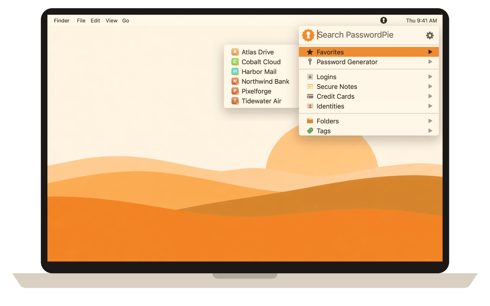

# PasswordPie

A keyboard-first KeePass password manager for Mac that lives in the menu bar.

**Website: [passwordpie.com](https://passwordpie.com/)**

## Download

[Download PasswordPie for Mac](https://github.com/Image-AI-LLC/PasswordPie/releases/latest/download/PasswordPie.dmg). Open the DMG and drag PasswordPie to Applications.

Requires macOS 14 or later on an Apple Silicon Mac. The DMG and the app are signed with Developer ID (Image AI, LLC) and notarized by Apple. Release notes and checksums are on the [releases page](https://github.com/Image-AI-LLC/PasswordPie/releases).

## What it does

- Press `⌘\` from any app, type a few letters, and copy: `⌃⌘C` username, `⇧⌘C` password, `⌥⌘C` one-time code
- Reads and writes standard KeePass KDBX 4 files, wherever you keep them. No account, no built-in sync
- Two-step codes (TOTP), a password generator, Large Type, and a pinned window that stays above other apps
- Touch ID unlock, auto-lock, and a clipboard that clears itself
- Imports KeePass 1, 1Password, Bitwarden, Proton Pass and CSV exports

More on [passwordpie.com](https://passwordpie.com/). Support: [support@passwordpie.com](mailto:support@passwordpie.com).

## Building

    make install          # direct channel, installs to ~/Applications
    make mas-dev          # App Store channel, sandboxed, for local testing
    Scripts/release-direct.sh   # signed, notarized DMG (see docs/CHANNELS.md)

Needs Xcode, Homebrew's `argon2`, and Node with `pnpm` for the browser extension (`extension/`, see [its README](extension/README.md)). Channel differences are in [docs/CHANNELS.md](docs/CHANNELS.md).

## License

The source code is licensed under the [PolyForm Noncommercial License 1.0.0](LICENSE): you may use, change and share it for personal and other noncommercial purposes, but not commercially. For a commercial license, write to [support@passwordpie.com](mailto:support@passwordpie.com).

That license covers this source code. The PasswordPie app you download from [passwordpie.com](https://passwordpie.com/) or the Mac App Store is free for anyone to install and use, including at work, under the [Terms of Service](https://passwordpie.com/terms-of-service). Two-step codes need PasswordPie Premium on a PasswordPie account, in both versions.

Copyright (c) 2026 Image AI, LLC.

## Contributing

We are not accepting outside pull requests for now. Bug reports and ideas are welcome as issues or at [support@passwordpie.com](mailto:support@passwordpie.com).

## Credits

Site popularity in search, and the list of sites whose icons are bundled, come from the [Majestic Million](https://majestic.com/reports/majestic-million), licensed under [CC BY 3.0](https://creativecommons.org/licenses/by/3.0/). The bundled site icons in `Assets/SiteIcons` are the trademarks of their sites' owners, shown only to identify the site an account belongs to; where each came from is listed in [`Assets/SiteIcons/SOURCES.md`](Assets/SiteIcons/SOURCES.md). Argon2 is used under CC0 1.0 / Apache 2.0.
